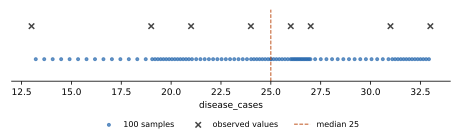

# How a forecast is made

## What a forecast looks like

Chap forecasts are **probabilistic**: for every location and future period, a model gives not one number but
100 **samples**, plausible values for that period's `disease_cases`. Together they describe how likely each
outcome is. Chap's metrics (CRPS, coverage of prediction intervals and so on) are computed from the samples,
and the median of the samples is the point forecast.

A prediction is a table with one row per location and future period, and columns `sample_0` to `sample_99`
(here the global median's forecast for location A of the [example data](verification.md)):

| time_period | location | sample_0 | sample_1 | ... | sample_99 |
|---|---|---|---|---|---|
| 2021-05 | A | 4.59 | 5.77 | ... | 32.61 |
| 2021-06 | A | 4.59 | 5.77 | ... | 32.61 |

## From observed values to samples

None of the baselines fits a distribution. Each picks a set of **observed values** that it considers
representative of the period to forecast, and turns that set into 100 samples by taking its **quantiles**.
The models differ only in which values they pick:

| model | values taken |
|---|---|
| global median | all observations of the location |
| seasonal median | observations of the location in the same month (or week) of the year |
| seasonal shift persistence | the last observed value, multiplied by ratios of earlier year-on-year changes |

The quantile levels are fixed (shared code in `baseline-core/src/quantiles.rs`):

- 99 levels evenly spaced and symmetric around one half: (i + 0.5) / 99 for i = 0 to 98, that is
  0.0051, 0.0152, ..., 0.5, ..., 0.9848, 0.9949;
- plus 0.5 once more, for 100 levels in all.

With 0.5 twice, the two middle samples are both the median, so the median of the samples is exactly the
median of the values.

Quantiles use **linear interpolation** (numpy's default): sort the values, and for level q take position
q × (n − 1) in the sorted list; between two values, interpolate. For example, for the three values 24, 27 and 31
the level 0.25 sits at position 0.25 × 2 = 0.5, halfway between 24 and 27, so its sample is 25.5. Samples never
go below the smallest or above the largest value.

*The 100 samples (dots) of a set of observed values (crosses): spread over the range of the values, denser
where the values are.*

## Missing values

Missing observations (empty cells, sent as `null`) are skipped: they neither count as zero nor shift the
quantiles. Each model also says what it does when a location has no usable values at all; see the fallbacks on
each model's page.
