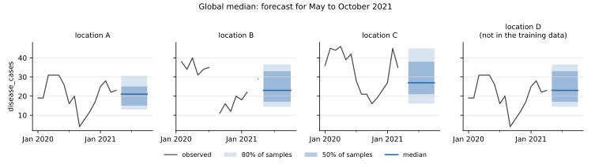

# Global median

**Package:** `baseline-global-median` · **Binary:** `baseline-global-median` · **Service id:** `global-median`
· **Port of:** chap-core `global_median` (version 2) · **Code:** `crates/baseline-global-median/src/model.rs`

## In one sentence

Every future period of a location is forecast with **all** of that location's observed `disease_cases`
from the training data.

## The method

1. **Training.** For each location, collect its observed (non-missing) cases from the training data and turn
   them into 100 quantile samples ([how](../forecasts.md#from-observed-values-to-samples)).
2. **Unseen locations.** For a location with no observations, take every other location's samples and, for each
   of the 100 quantile levels, their median. Because every location's samples are sorted, so is the result.
3. **Forecast.** Every future period of a location gets the location's samples, unchanged: the same forecast
   for May, June and December.

There is no trend, no seasonality and no fitting. The median of the forecast is the median of the
location's history, and the spread is the spread of its history.

## Worked example

Location A in the [example data](../verification.md) has 40 monthly observations from January 2018 to April
2021, between 4 and 33 cases, with median 21. Its forecast for May 2021, and every month after:

| | value |
|---|---|
| median (point forecast) | 21.0 |
| sample 10 (about the 10th percentile) | 13.0 |
| sample 89 (about the 90th percentile) | 30.6 |

Location D has no training data at all. Its samples are the per-level median of A's, B's and C's samples,
with median 23.0.



*History (line) and forecast (median, with the middle 50% and 80% of the samples shaded) for each location
of the example data. The forecast is flat: every month gets the same samples.*

## When it is useful

As the simplest yardstick: a model should at least beat "what usually happens here". It is robust to outliers
(the median moves little) and to missing data, and needs no seasonal structure, so it accepts any period
format (months, weeks, or anything else).

Its weakness is the same as its simplicity: it ignores seasons and trends, so in seasonal diseases it forecasts
too much in the low season and too little in the high one.

## Inputs and outputs

| | |
|---|---|
| training data | `time_period`, `location`, `disease_cases` (other columns are ignored) |
| configuration | none |
| output | 100 samples per location and future period |
| fails when | no location in the training data has any observed case |

## In code

```rust,ignore
/// Training, for one location: the quantiles of its observed (non-missing) cases.
pub fn location_samples(cases: &[f64]) -> Option<Vec<f64>> {
    let observed: Vec<f64> = cases.iter().copied().filter(|c| c.is_finite()).collect();
    quantile_samples(&observed)
}
```

The rest of `model.rs` keeps the samples per location and the fallback for unseen locations;
`src/lib.rs` splits the training table per location (in parallel) and assembles the prediction table.
