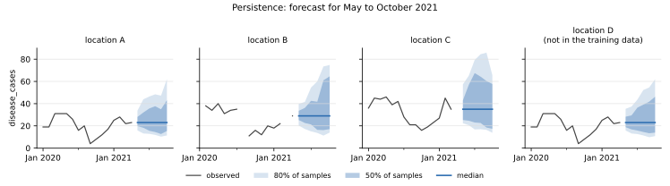

# Persistence

**Package:** `baseline-persistence` · **Binary:** `baseline-persistence` · **Service id:** `persistence-crs`
· **Port of:** chap-core `persistence` (version 2, chap-core 2.7.0) · **Code:** `crates/baseline-persistence/src/model.rs`

## In one sentence

Forecast the **last observed value**, with a spread taken from how much cases changed over the same distance in
the training data.

## The method

**Log differences (training).** For a location's series y₁, y₂, ... and a horizon *h* from 1 to one year (12
months or 52 weeks), every pair of periods *h* apart gives a difference

```text
d = ln(y_t + 1) − ln(y_{t-h} + 1)
```

the change on a log scale. Adding 1 keeps zero counts usable: 0 → 3 cases gives ln 4, not the logarithm of
zero. A missing value on either side gives no difference. Unlike [seasonal shift
persistence](seasonal-shift-persistence.md), the differences are not split by season: every pair *h* apart
counts, whatever the time of year.

**Forecast.** For a future period *h* periods after the last observed value *y*:

1. take the location's differences for horizon *h*;
2. subtract their median (**centring**);
3. turn them into 100 quantile samples c₀ ... c₉₉ ([how](../forecasts.md#from-observed-values-to-samples));
4. forecast `sample_i = max((y + 1) × exp(c_i) − 1, 0)`.

Centring puts the median sample at exactly *y*: a trend in the training data does not move the forecast, only
the spread comes from the data. Further ahead, the differences cover longer stretches and vary more, so the
spread widens with the horizon.

**When differences are missing**, horizon by horizon from *h* down to 1:

1. **The location's own differences** for the horizon, if there are at least two (a single difference is 0
   once centred, so it gives no spread).
2. **All locations' differences** for the horizon pooled together, if there are at least two.
3. **The next shorter horizon**, trying 1 and 2 again (a horizon longer than the training data, or than a
   year, has none).
4. **Nothing anywhere**: the last value is forecast unchanged.

A location without any observed value in the historic data has nothing to persist and cannot be forecast.

## Worked example

Location A in the [example data](../verification.md): the last observed value is April 2021, 23 cases.

**May 2021** is one month ahead (*h* = 1). The training data has 40 months for A, January 2018 to April 2021,
with none missing, so 39 month-to-month differences. The first five:

| months | cases | difference ln(y_t + 1) − ln(y_{t-1} + 1) |
|---|---|---|
| Jan → Feb 2018 | 24 → 31 | ln(32 / 25) = 0.247 |
| Feb → Mar 2018 | 31 → 33 | ln(34 / 32) = 0.061 |
| Mar → Apr 2018 | 33 → 23 | ln(24 / 34) = −0.348 |
| Apr → May 2018 | 23 → 27 | ln(28 / 24) = 0.154 |
| May → Jun 2018 | 27 → 27 | ln(28 / 28) = 0 |

Six of the 39 are 0 (no change), and their median is 0, so centring changes nothing here. They range from
−1.435 (August → September 2020, 20 → 4 cases) to 0.629 (October → November 2019, 7 → 14). The median forecast
is (23 + 1) × exp(0) − 1 = **23.0**, and samples 10 to 89 lie between 15.95 and 33.66; the most extreme samples
are 5.76 and 43.65.

**June 2021** is two months ahead (*h* = 2): 38 differences, with median −0.020. Centred, the median forecast is
again 23.0, with a wider spread: 13.19 to 43.73 between samples 10 and 89.

**October 2021** is six months ahead (*h* = 6): 34 differences, with median −0.172 (18 of them fall, 16 rise).
Without centring the median forecast would be (23 + 1) × exp(−0.172) − 1 = 19.2; centred it stays at **23.0**,
and samples 10 to 89 lie between 11.47 and 61.97.

**Location C** has April 2021 missing in the historic data, so its last observed value is March 2021, 35 cases.
May 2021 is then two periods after it and uses C's *h* = 2 differences: median 35.0, samples 10 to 89 between
22.33 and 57.15.

**Location D** appears in the historic data but not in the training data, so it has no differences of its own
and uses those of A, B and C pooled (fallback 2): for May 2021, 104 differences with median 0, so the median
forecast is its last value, 23.0, with samples 10 to 89 between 15.88 and 35.16.



*History (line) and forecast (median, with the middle 50% and 80% of the samples shaded). The median is flat at
the last observed value; the band widens as the horizon grows.*

## When it is useful

It is the simplest forecast that keeps the **current level**: "next month looks like this month", with an
honest spread around it. It is the natural yardstick for short horizons and for series without a clear
seasonal pattern, and centring makes it neutral: it never extrapolates a trend.

It ignores the time of year, so on seasonal data it is beaten by the seasonal models further ahead, and it
carries a single odd last value (an outlier or a reporting error) through the whole forecast.

## Inputs and outputs

| | |
|---|---|
| training data | `time_period` (monthly or weekly), `location`, `disease_cases` |
| historic data | the series up to the forecast start; its last observed value is the starting point |
| configuration | none |
| output | 100 samples per location and future period, never negative; the median is the last observed value |
| fails when | a period is not monthly or weekly, or a location to forecast has no observed value in the historic data |

## In code

```rust,ignore
/// The forecast samples: the last value moved by each centred difference, never below zero.
pub fn forecast(last_value: f64, spread: &[f64]) -> Vec<f64> {
    spread
        .iter()
        .map(|c| ((last_value + 1.0) * c.exp() - 1.0).max(0.0))
        .collect()
}
```

`log_cases` and `differences` compute the differences, `centred` subtracts their median, and
`PersistenceTrained::spread` applies the fallbacks, all in `model.rs`.
