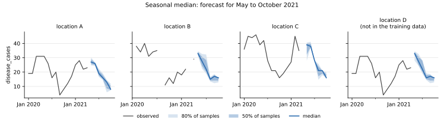

# Seasonal median

**Package:** `baseline-seasonal-median` · **Binary:** `baseline-seasonal-median` · **Service id:** `seasonal-median`
· **Port of:** chap-core `seasonal_median` (version 2) · **Code:** `crates/baseline-seasonal-median/src/model.rs`

## In one sentence

A future period is forecast with the location's observations from **the same month (or week) of the year**
in the training data: May is forecast from every earlier May.

## The method

**Season.** Every period has a *period of year*: its month (1 to 12) for monthly data, its week (1 to 52) for
weekly data. Week 53, which some years have, counts as week 52.

1. **Training.** For each location and each season, collect the location's observed cases in that season and
   turn them into 100 quantile samples ([how](../forecasts.md#from-observed-values-to-samples)).
2. **Forecast.** A future period in season *s* gets the location's samples for *s*.

When there is nothing to take quantiles of, in this order:

| situation | forecast |
|---|---|
| the location has observations, but none in season *s* | the location's [global median](global-median.md) samples (all seasons) |
| the location has no observations at all | per quantile level, the median of every other location's samples for season *s* |
| no location has observations in season *s* | the global median fallback: the median of all locations' samples over all seasons |

The median of a forecast is the median of the same-season observations, and its spread is how much that
season varied between years.

## Worked example

Location A in the [example data](../verification.md), trained on January 2018 to April 2021:

| forecast for | observations used | median |
|---|---|---|
| May 2021 | May 2018: 27, May 2019: 24, May 2020: 31 | 27.0 |
| June 2021 | 27, 24, 26 | 26.0 |
| July 2021 | 19, 23, 16 | 19.0 |
| October 2021 | 13, 7, 8 | 8.0 |

Location B is missing June 2019. Its June forecast uses the two Junes it has, 21 and 34, with median 27.5:
missing values are skipped, not counted as zero.

Location D has no training data, so it gets the third row of the table above: for each month, the per-level
median of A's, B's and C's samples for that month (May: median 33.0).



*History (line) and forecast (median, with the middle 50% and 80% of the samples shaded). The forecast
follows the seasonal pattern of earlier years.*

## When it is useful

For diseases with a strong yearly cycle (malaria, dengue, influenza), "the same month in earlier years" is a
much stronger yardstick than the overall median. With few years of history the spread is narrow and rough
(three Mays give three values); it improves as years accumulate.

It does not see trends: if cases have been rising for years, earlier years drag the forecast down.

## Inputs and outputs

| | |
|---|---|
| training data | `time_period` (monthly or weekly), `location`, `disease_cases` |
| configuration | none |
| output | 100 samples per location and future period |
| fails when | a period is not monthly or weekly, or no location has any observed case |

## In code

```rust,ignore
/// Training, for one location: for each season with observations, the quantiles of the
/// observed cases in that season.
pub fn season_samples(cases: &[f64], seasons: &[u32]) -> BTreeMap<u32, Vec<f64>> {
    // Collect the observed (non-missing) cases of each season ...
    let mut observed: BTreeMap<u32, Vec<f64>> = BTreeMap::new();
    for (&case, &season) in cases.iter().zip(seasons) {
        if case.is_finite() {
            observed.entry(season).or_default().push(case);
        }
    }
    // ... and turn each season's observations into samples.
    observed
        .into_iter()
        .filter_map(|(season, values)| Some((season, quantile_samples(&values)?)))
        .collect()
}
```

`SeasonalMedianTrained::samples` in the same file applies the fallbacks in the order of the table above.
