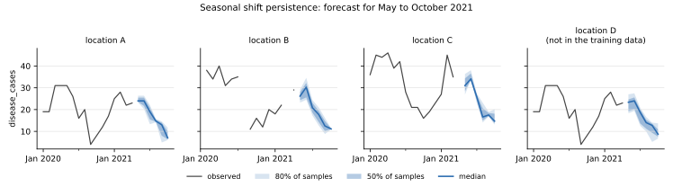

# Seasonal shift persistence

**Package:** `baseline-seasonal-shift-persistence` · **Binary:** `baseline-seasonal-shift-persistence`
· **Service id:** `seasonal-shift-persistence` · **Port of:** chap-core `seasonal_shift_persistence` (version 1)
· **Code:** `crates/baseline-seasonal-shift-persistence/src/model.rs`

## In one sentence

Start from the **last observed value** and scale it by how cases changed over the same distance and time of
year in earlier years.

## The method

**Ratios (training).** For a location's series y₁, y₂, ... and a horizon *h* from 1 to one year (12 months or
52 weeks), every pair of periods *h* apart gives a ratio

```text
r = (y_t + 1) / (y_{t-h} + 1)
```

filed under the season (month or week of the year) of *t*. Adding 1 keeps zero counts usable: 0 → 3 cases
gives the ratio 4, not a division by zero. A missing value on either side gives no ratio.

**Forecast.** For a future period *h* periods after the last observed value *y*, in season *s*:

1. take the location's ratios for horizon *h* and season *s*;
2. turn them into 100 quantile samples r₀ ... r₉₉ ([how](../forecasts.md#from-observed-values-to-samples));
3. forecast `sample_i = max((y + 1) × r_i − 1, 0)`.

The median is *y* scaled by the median ratio. Further ahead, the ratios cover longer stretches and vary more,
so the spread widens with the horizon.

**When ratios are missing**, in this order:

1. **No ratios for season *s*** at this horizon: the ratios of the nearest seasons before and after *s* in the
   year together; if *s* has no season on one side, the ratios of every season.
2. **The location has none for the horizon**: all locations' ratios pooled together.
3. **The horizon has none at all** (longer than the training data, or than a year): the longest shorter
   horizon that has them.
4. **A single ratio** gives no spread, so a later candidate in this order with more than one ratio is preferred.
5. **No ratio anywhere**: the last value is forecast unchanged (ratio 1).

A location without any observed value in the historic data has nothing to persist and cannot be forecast.

## Worked example

Location A in the [example data](../verification.md): the last observed value is April 2021, 23 cases.

**May 2021** is one month ahead (*h* = 1, season May). The training data has three April → May changes:

| year | April | May | ratio (May + 1) / (April + 1) |
|---|---|---|---|
| 2018 | 23 | 27 | 28 / 24 = 1.167 |
| 2019 | 23 | 24 | 25 / 24 = 1.042 |
| 2020 | 31 | 31 | 32 / 32 = 1.000 |

The median ratio is 1.042, so the median forecast is (23 + 1) × 1.042 − 1 = **24.0**. The samples spread
between (23 + 1) × 1.0 − 1 = 23 and (23 + 1) × 1.167 − 1 = 27.

**June 2021** is two months ahead (*h* = 2, season June): ratios of April → June changes, 28/24, 25/24 and
27/32 = 1.167, 1.042 and 0.844; median forecast again 24.0, but with a wider spread (20.3 to 26.4 between
samples 10 and 89).

**Location D** appears in the historic data but not in the training data, so it has no ratios of its own and
uses all locations' ratios pooled (fallback 2).



*History (line) and forecast (median, with the middle 50% and 80% of the samples shaded). The forecast starts
at the last observed value and follows how earlier years moved from that month on.*

## When it is useful

It combines two things the medians lack: the **current level** (the last value) and the **seasonal shape**
(how cases usually change from this month on). After an unusually high or low month it stays near that level
instead of reverting to the long-run median, which suits outbreaks and multi-year trends.

It reacts to a single odd last value: if the last month was an outlier or a reporting error, the whole
forecast carries it.

## Inputs and outputs

| | |
|---|---|
| training data | `time_period` (monthly or weekly), `location`, `disease_cases` |
| historic data | the series up to the forecast start; its last observed value is the starting point |
| configuration | none |
| output | 100 samples per location and future period, never negative |
| fails when | a period is not monthly or weekly, or a location to forecast has no observed value in the historic data |

## In code

```rust,ignore
/// The forecast samples: the last value scaled by the quantiles of the ratios, never below zero.
pub fn forecast(last_value: f64, ratios: &[f64]) -> Option<Vec<f64>> {
    Some(
        quantile_samples(ratios)?
            .into_iter()
            .map(|r| ((last_value + 1.0) * r - 1.0).max(0.0))
            .collect(),
    )
}
```

`SeasonalShifts::from_cases` computes the ratios, `SeasonalShifts::ratios` applies fallback 1 and
`SeasonalShiftTrained::ratios` fallbacks 2 to 5, all in `model.rs`.
